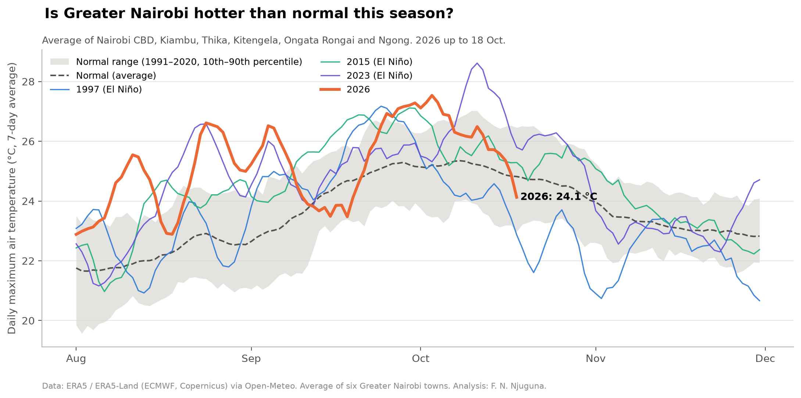
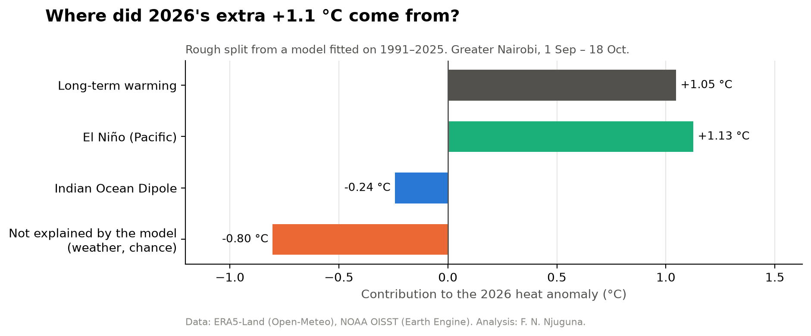
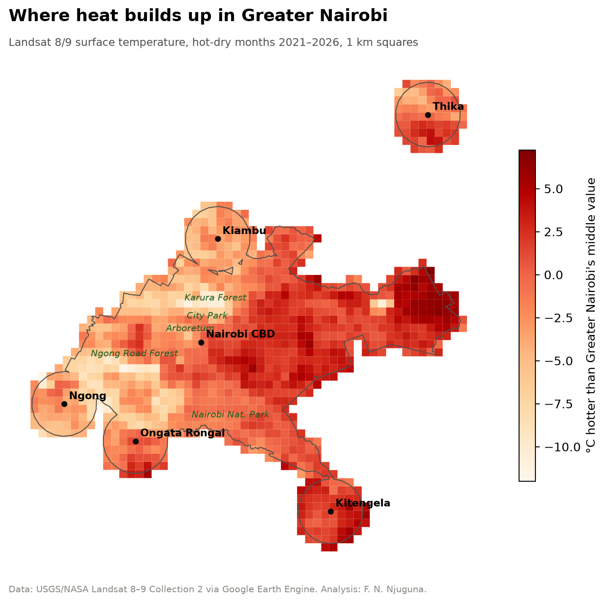
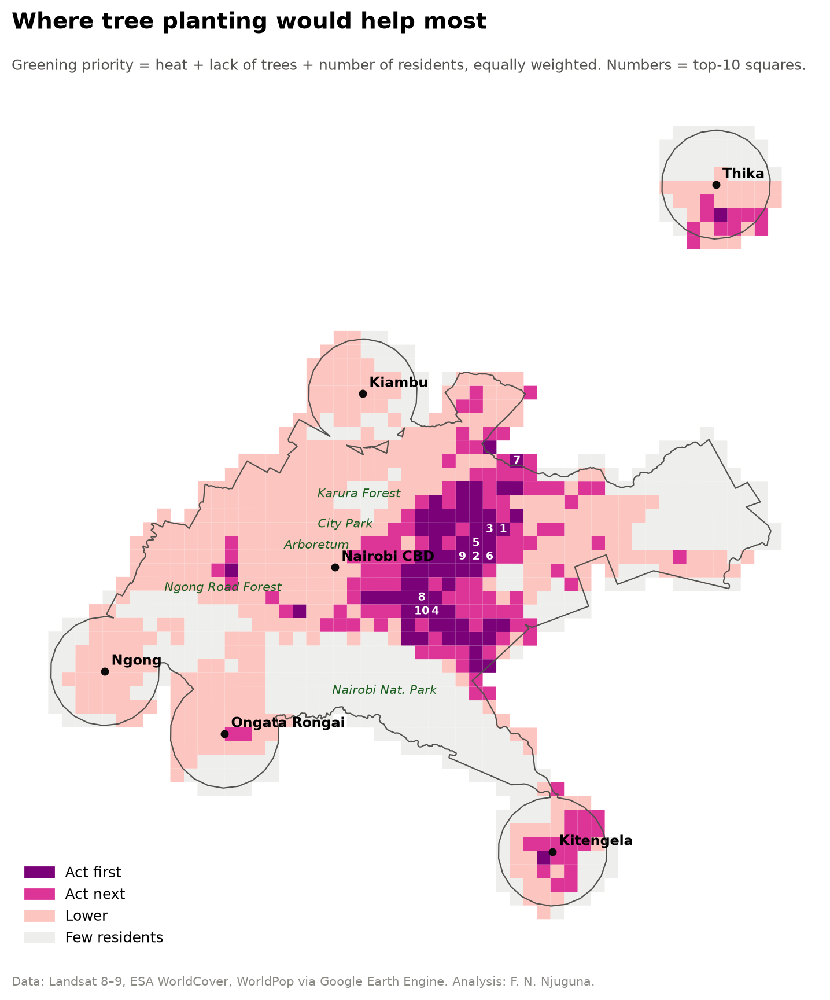

# Hot Under El Niño? Greater Nairobi's 2026 heat, and what would cool it

A self-initiated analysis by **Fides Njeri Njuguna**, geospatial analyst, Nairobi.

During the strong 2026 El Niño, people across Nairobi kept asking: *"They said El Niño, so why is it so hot?"* This project answers that with open satellite and climate data for Nairobi County, Kiambu, Thika, Kitengela, Ongata Rongai and Ngong.

## Key findings

| Finding | Result |
|---|---|
| 2026 afternoon heat, 1 Sep – 18 Oct, vs the 1991–2020 normal | **+1.1 °C**, 5th hottest of 36 years |
| Late rains or clear skies? | **Ruled out.** Rain at 86% of normal, rains not yet due, sunshine normal |
| El Niño | **Clear link:** +0.54 °C per 1 °C of relative Pacific warmth (2026: +2.1 °C) |
| Long-term warming | **Clear link:** about +0.5 °C per decade in this dataset |
| Cooling from trees | About **1.0 °C cooler ground per extra 10% tree cover** (same altitude and building density) |
| Reach of a green space's cooling | About **4 °C** cooler next to a 1 ha+ tree patch; fades by about **450 m** |
| 3-30-300 green standard | **86% of residents** live in areas that miss it |
| Greening the 208 highest-priority 1 km squares to 30% canopy | Roughly **2.6 °C cooler surfaces for about 3 million residents** (estimate) |

**In one sentence:** the heat isn't late rains. It fits a strong El Niño warming the tropical air on top of long-term warming. El Niño brings the heat first, and its rains come later.

## Results

| Is it hotter than normal? | Where did the extra heat come from? |
|---|---|
|  |  |

| Where heat builds up | Where tree planting would help most |
|---|---|
|  |  |

More charts are in [`outputs/`](outputs) and [`outputs_02/`](outputs_02). Open `outputs_02/interactive_map.html` in a browser for a zoomable map.

## Notebooks

| Notebook | Question |
|---|---|
| [`01_why_is_greater_nairobi_hot.ipynb`](01_why_is_greater_nairobi_hot.ipynb) | Why has it been so hot, and is El Niño behind it? |
| [`02_where_is_it_hottest_and_what_would_cool_it.ipynb`](02_where_is_it_hottest_and_what_would_cool_it.ipynb) | Where is it hottest, and what would cool it? |

Every step is explained in plain language, with the reason for each choice.

## Data

All open data, processed in Google Earth Engine and Python (geemap, pandas, geopandas, statsmodels):

- **ERA5 / ERA5-Land** reanalysis (ECMWF, Copernicus), via Open-Meteo: daily air temperature, rain and sunshine, 1991–2026
- **NOAA OISST v2.1**: El Niño (relative Niño 3.4, NOAA's method since 2026) and the Indian Ocean Dipole
- **CHIRPS v3**: cross-check of rain-onset dates
- **Landsat 8–9 Collection 2**: 30 m surface heat, hot-dry months 2021–2026
- **Sentinel-2** and **ESA WorldCover 2021**: greenness and tree cover
- **WorldPop 2020** and **SRTM**: residents and altitude

## How to run

With Miniconda or Anaconda installed:

```
conda env create -f environment.yml
conda activate nairobi-heat
earthengine authenticate
```

(Without conda: `python -m venv .venv`, activate it, then `pip install -r requirements.txt`.)

1. Put your own Earth Engine Cloud project ID in `GEE_PROJECT` in the settings cell of each notebook.
2. Run notebook 01, then notebook 02, from top to bottom.
3. Results are saved to `outputs/` and `outputs_02/`.

## Limitations

- The findings are statistical associations, not formal climate attribution.
- The warming rate is on the high side of published Kenyan figures; weather-station data would firm it up.
- Rain-onset dates are approximate (ERA5 and CHIRPS typically differ by about two weeks).
- Satellites measure surface temperature (roofs, roads, soil), not the air temperature people feel.
- Satellite surface temperature showed no clear signal for 2026 as a whole, so it's used only to compare places on the same dates.
- WorldCover counts plantations as tree cover, and WorldPop is a 2020 model.

Each notebook ends with a full list of limitations.
